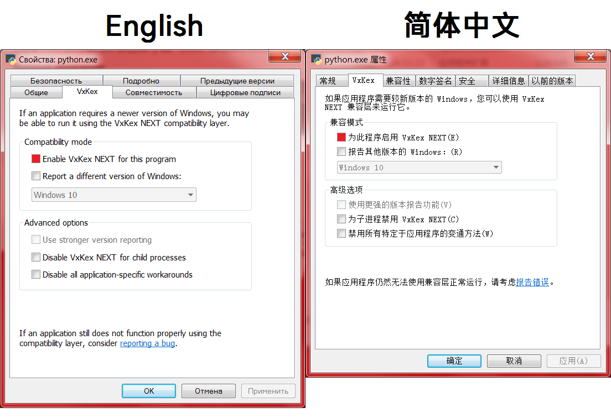

# VxKex FULL Kernel

VxKex is a set of API extensions for Windows that let some newer Windows-exclusive
applications (targeting Windows 8, 8.1, 10 or 11 APIs) run on older Windows
versions — **Windows 7, 8 and 8.1**.

It does **not** modify any system files, does not install background services,
and does not use global hooks. It works by registering an IFEO
(`Image File Execution Options`) entry that loads `KexDll` into the target
process, which then redirects the program's DLL imports to VxKex's own
implementations of newer Windows APIs.

This repository is a **merge of three community forks** of the original
project, combining the most complete and actively-maintained feature set
available across all of them. See [Origin & attribution](#origin--attribution)
below for details, and [CLAUDE.md](CLAUDE.md) / [CLAUDE_CONTEXT.md](CLAUDE_CONTEXT.md)
for a full technical breakdown of what was merged and why.



## Features

- Enables many Qt6 and Electron applications, plus a wide range of individual
  apps (browsers, dev tools, media tools, games) to run on Windows 7/8/8.1.
  See `00-Documentation/Application Compatibility List.docx` for the full,
  per-application configuration notes.
- **Windows 7, 8 and 8.1 support** (the original i486/VxKex only supports
  Windows 7).
- **Localization**: UI and documentation available in English, Simplified/
  Traditional Chinese, Russian, Ukrainian and Czech (`README_IN_OTHER_LANGUAGES/`).
- Full **TLS 1.2 / TLS 1.3** implementation (`KxSChanl`) for connecting to
  modern websites and services from older Windows versions.
- Compatibility bypass for conflicts with **0patch Agent** and **MacType**
  (`CpiwBypa`).
- Application-specific patches for Chromium, Firefox, Java, Qt6, Unity6 and
  others.
- Includes source for the full stack: user-mode API shim DLLs, the shell
  extension, the GUI configuration tool, the installer, and a (currently
  minimal) kernel-mode driver — see [Project structure](#project-structure).

## Installing (end users)

Right-click a program (`.exe` or `.msi`) → **Properties** → the **VxKex**
tab → check **"Enable VxKex NEXT for this program"**. For a program you
don't want to right-click individually, use **"VxKex NEXT Global Settings"**
from the Start menu instead.

Some programs need extra configuration steps — check
`00-Documentation/Application Compatibility List.docx` (installed alongside
VxKex) first.

## Building from source

Requires **Windows** with one of the supported MSBuild toolsets — this
project cannot be built or tested outside Windows.

| Toolset | Value for `PlatformToolset` |
|---|---|
| Windows SDK 7.1 (standalone, used by CI) | `Windows7.1SDK` |
| Visual Studio 2010 | `v100` |
| Visual Studio 2012 (Windows XP tools) | `v110_xp` |
| Visual Studio 2013 (Windows XP tools) | `v120_xp` |
| Visual Studio 2015 (Windows XP tools) | `v140_xp` |

From a Visual Studio / Windows SDK command prompt:

```bat
01-Development Utilities\Build_Stable_Version_And_Clean.bat
```

This builds Debug and Release, for both Win32 and x64 (**x86 must be built
before x64** — the x64 build consumes tools produced by the x86 build), then
cleans up. See [CLAUDE.md](CLAUDE.md) for individual build/clean commands and
the raw `MSBuild.exe` invocations used by CI (`.github/workflows/build.yml`).

## Project structure

High-level map only — see [CLAUDE.md](CLAUDE.md) for the full breakdown of
every module and what API surface each one reimplements.

```
00-Common Headers/        Shared headers used across all modules
01-Extended DLLs/         The "Kx*" DLLs — reimplementations of modern Win32/COM/DirectX/TLS APIs
01-Development Utilities/ Build scripts, versioning tool (vautogen), dev tools
KexDll/                   Core: DLL injection, import redirection, NT-level shims, logging
KexSetup/                 Installer
KexShlEx/, KexCfg/        The "VxKex" Properties tab and its configuration logic
KexKMSD/                  Kernel-mode driver (currently a minimal stub)
KexMLS/, KexSmp/          Localization and string-mapping infrastructure
VxKexLdr/, VxlView/       Process launcher and log viewer
CpiwBypa/, CpiwBypaLdr/   0patch/MacType compatibility bypass
```

## Documentation for contributors & AI-assisted development

This repository maintains two living documents specifically so that
development context survives across sessions (including AI-assisted ones):

- **[CLAUDE.md](CLAUDE.md)** — architecture, conventions, build/test commands.
  Read this first to understand how the project is put together.
- **[CLAUDE_CONTEXT.md](CLAUDE_CONTEXT.md)** — current development state,
  known gaps between the three merged forks, technical decisions and their
  rationale, and the recommended next steps. **Read this before making any
  significant change** — it records exactly what has and hasn't been
  reconciled between the merged codebases yet.

## Origin & attribution

This codebase merges three repositories that share the same git root commit:

- **[i486/VxKex](https://github.com/i486/VxKex)** by **vxiiduu** — the
  original project. Windows 7 only, actively maintained independently.
- **[tester9071348/VxKex-Extended](https://github.com/tester9071348/VxKex-Extended)**
  — forked from i486 in March 2024. Added the `CpiwBypa` compatibility
  bypass and an expanded application compatibility list.
- **[YuZhouRen86/VxKex-NEXT](https://github.com/YuZhouRen86/VxKex-NEXT)**
  (also on [Gitee](https://gitee.com/YuZhouRen86/VxKex-NEXT)) — forked from
  VxKex-Extended in February 2025. Added localization, Windows 8/8.1 support,
  a full TLS 1.2/1.3 stack, and additional modules (DirectWrite, UI
  Automation). The most complete and actively-maintained of the three, and
  the base this merge was built on.

Full merge methodology, and a prioritized list of functionality present in
i486/Extended that has not yet been reconciled into this tree, is documented
in [CLAUDE_CONTEXT.md](CLAUDE_CONTEXT.md).

**Note on licensing:** no `LICENSE` file was found in any of the three source
repositories. Terms for redistribution have not been clarified — check with
the original authors before redistributing binaries built from this tree.

## Support the original authors

If you'd like to support development of the upstream projects this merge is
built on, see the donation links in each upstream README
([i486/VxKex](https://github.com/i486/VxKex#donations),
[VxKex-NEXT](https://github.com/YuZhouRen86/VxKex-NEXT#donations--%E6%8D%90%E8%B5%A0)).
